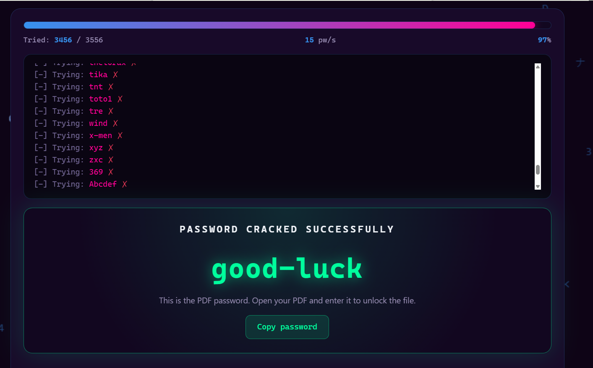

# Week 03 — Password Cracking

**Course:** Cybersecurity & Ethical Hacking Project Tasks
**Week:** 03 | Project Module 1 + Project Module 2
**Source:** Networkwalks — www.networkwalks.com

---

## Overview

In Week 03, I completed two project modules on password cracking using lab-provided files in an authorized training environment.

- **PM1:** Password Cracking with JTR
- **PM2:** Password Cracking with Networkwalks Tools

Both modules used the same lab file: `My Locked PDF1.pdf`

---

## PM1 — Password Cracking with JTR

### Background

John the Ripper (JTR) is a popular password cracking tool used by security professionals to test how strong passwords are. It started as a tool for Unix systems but now works on Windows, Linux, and Mac. It can check many types of password hashes and also unlock password protected files like PDF, ZIP, and Office documents.

Johnny is the graphical version of John the Ripper. It gives a simple point and click screen, so beginners can use JTR without typing long commands.

### Task

Crack the password of attached PDF file (My Locked PDF1.pdf) using JTR JOHN and JTR JOHNNY tools on your Windows PC.

> Note: If you are using Kali Linux then you can open JTR (John The Ripper) directly because it comes pre-installed in Kali Linux.

### Tools Used

- John the Ripper (JTR) — https://www.openwall.com/john/
- Johnny GUI — https://openwall.info/wiki/john/johnny
- Online Hash Extractor — https://www.onlinehashcrack.com/tools-pdf-hash-extractor.php

### Steps Performed

**Step 1 — Install JTR & Johnny**
- Downloaded John the Ripper for Windows PC.
- Downloaded and installed Johnny GUI.

**Step 2 — Configure Johnny**
- Opened Johnny.
- Went to Settings and browsed to `john.exe` file located in the `run` folder.

**Step 3 — Extract Hash from PDF**
- Downloaded the encrypted PDF file.
- Uploaded PDF to Online Hash Extractor tool.
- Copied the hash value starting with `$pdf$...`
- Removed extra characters like `b'` if present.
- Pasted hash in Notepad and saved as `hash1.txt`.

**Step 4 — Crack Password in Johnny**
- Opened Johnny again.
- Clicked on `Open password file` and selected `hash1.txt`.
- Clicked on `Start new attack`.
- Password was cracked.

**Step 5 — Verify**
- Opened the encrypted PDF.
- Entered the cracked password.
- PDF file opened successfully.

---

## PM2 — Password Cracking with Networkwalks Tools

### Background

Password cracking is the process of recovering a password from stored data or a protected file. Security professionals use it to test how strong a password is and to show why weak passwords are risky. If a password is short or common, it can be found quickly, which proves the need for strong passwords.

Many files like PDF, ZIP, and Office documents can be locked with a password. When a file is locked, its password is stored in the form of a hash. A hash is a scrambled value that represents the password. To recover the password, we first take out this hash from the file, and then run it through a cracking tool that tries different words until it finds a match.

In this lab you will use two free online tools made by Networkwalks. First you will use the Hash Calculator to take the hash out of a locked PDF file. Then you will use the Password Cracker to find the real password from that hash. Both tools run in your web browser, so you do not need to install anything.

### Task

Crack the password of the attached PDF file (My Locked PDF1.pdf) using the Networkwalks Hash Calculator and Password Cracker tools on your Windows laptop.

> Note: You can also do this lab on Kali Linux, as both tools run in any web browser.

### Tools Used

- Networkwalks Hash Calculator — https://networkwalks.com/hash-calculator/
- Networkwalks Password Cracker — https://networkwalks.com/password-cracker/
- Lab File Page — https://networkwalks.com/project-task-lab-password-cracking-with-networkwalks-tools/

### Steps Performed

**Step 1 — Download Lab File**
- Downloaded the encrypted PDF file (My Locked PDF1.pdf) to laptop from the lab page.

**Step 2 — Open Hash Calculator**
- Opened the Networkwalks Hash Calculator in web browser.

**Step 3 — Upload PDF & Get Hash**
- Uploaded the locked PDF file to the Hash Calculator.
- Tool read the file and gave hash value starting with `$pdf$...`

**Step 4 — Copy Hash**
- Copied the full hash value starting from `$pdf$`. Did not miss any part.

**Step 5 — Open Password Cracker**
- Opened the Networkwalks Password Cracker in web browser.

**Step 6 — Paste Hash & Start Attack**
- Pasted the hash value into the Password Cracker and started the attack.
- Tool tried different passwords until it found a match.

**Step 7 — Get Cracked Password**
- Waited for tool to finish. Cracked password was shown on screen.
- Time taken depends on how simple or complex the password is.

**Step 8 — Verify**
- Opened the locked PDF file and entered the cracked password.
- PDF file opened. Lab completed.

---

## Results Summary

| Task | Tool Used | Status |
| :--- | :--- | :--- |
| W3-PM1 | JTR John + Johnny | ✅ Completed |
| W3-PM2 | Networkwalks Hash Calculator + Password Cracker | ✅ Completed |
| Verification | PDF Opened | ✅ Verified |

*Detailed passwords and flags are intentionally not published for security best practice.*

## Proof of Execution

### PM1 — Johnny Result
.png)

### PM2 — Networkwalks Cracker Result

### Flag / Verification

## Key Learning

This exercise helps to learn how password cracking works and why it is important to use strong passwords for protection.

---
**Author:** Ahmad Raza — Ghallu305
**Week:** 03 / Networkwalks
